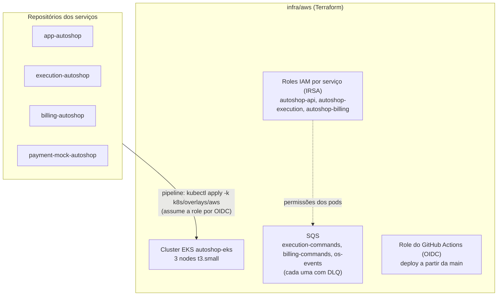

# infra-k8s-autoshop

Infraestrutura compartilhada pelos microsserviços do AutoShop, em
Terraform: o cluster Kubernetes (EKS), as filas da Saga (SQS) e as
permissões de cada serviço na AWS. Não contém manifestos de aplicação:
cada serviço versiona e aplica os próprios manifestos no seu repositório.

| Repositório | Papel |
|---|---|
| [`app-autoshop`](https://github.com/Jackeline2020/app-autoshop) | OS Service e orquestrador da Saga |
| [`execution-autoshop`](https://github.com/Jackeline2020/execution-autoshop) | Execution Service |
| [`billing-autoshop`](https://github.com/Jackeline2020/billing-autoshop) | Billing Service |
| [`payment-mock-autoshop`](https://github.com/Jackeline2020/payment-mock-autoshop) | Mock do provedor de pagamento |
| [`lambda-auth-autoshop`](https://github.com/Jackeline2020/lambda-auth-autoshop) | Autenticação por CPF |
| [`infra-db-autoshop`](https://github.com/Jackeline2020/infra-db-autoshop) | Bancos de dados de cada serviço |
| **`infra-k8s-autoshop`** (este) | Cluster, filas e permissões |

## Arquitetura



- **Cluster:** EKS na VPC padrão da conta, com 3 nodes `t3.small`
  (11 pods por node, suficientes para os 4 serviços, os jobs de migration
  e o agente do New Relic).
- **Filas da Saga** (`infra/aws/messaging.tf`): uma fila de comandos por
  serviço e a fila de eventos do orquestrador. Cada uma tem uma DLQ: depois
  de 5 tentativas sem sucesso, a mensagem é separada para análise.
- **Permissões por serviço** (`infra/aws/irsa.tf`): cada serviço roda com
  uma role IAM própria, assumida pela service account do pod, sem chave
  fixa. Cada role só acessa as filas do próprio serviço (e, no Execution,
  as tabelas DynamoDB `autoshop-*`).

| Serviço | Consome | Publica | Outros |
|---|---|---|---|
| OS (`autoshop-api`) | `os-events` | `execution-commands`, `billing-commands` | — |
| Execution | `execution-commands` | `os-events` | DynamoDB `autoshop-*` |
| Billing | `billing-commands` | `os-events` | — |

- **Deploy pelo GitHub Actions** (`infra/aws/github-oidc.tf`): os
  repositórios dos serviços assumem a role `autoshop-github-actions` por
  OIDC, só a partir da branch `main`, e aplicam os próprios manifestos.

Detalhes de cada pasta e o passo a passo em [`docs/infra.md`](docs/infra.md).

## Como aplicar (AWS)

Pré-requisitos: Terraform >= 1.5, AWS CLI com credenciais
(`aws sts get-caller-identity` respondendo) e `kubectl`.

```bash
cd infra/aws
terraform init
terraform plan -out=plano
terraform apply plano          # 15 a 20 minutos (a maior parte é o EKS)

aws eks update-kubeconfig --region us-east-1 --name autoshop-eks
kubectl get nodes
```

As saídas são usadas no `infra-db-autoshop` e nos secrets dos
repositórios dos serviços:

| Saída | Uso |
|---|---|
| `eks_node_security_group_id` | Variável das stacks `os/` e `billing/` do `infra-db-autoshop` (libera os bancos para os nodes) |
| `github_actions_role_arn` | Secret `AWS_ROLE_ARN` dos repositórios que fazem deploy |
| `irsa_role_arns` | Secret `IRSA_ROLE_ARN` de cada serviço (`app`, `execution`, `billing`) |
| `queue_urls` | Conferência das filas (os serviços descobrem as URLs pelo nome) |

Ordem completa para subir o ambiente:

1. `infra-k8s-autoshop/infra/aws`: cluster, filas e roles
2. `infra-db-autoshop`: stacks `os`, `billing` e `execution`
3. Secrets nos repositórios dos serviços e variável `AWS_DEPLOY_ENABLED=true`
4. Merge `develop → main` em cada serviço: o pipeline faz o deploy

## Como destruir

Os Load Balancers dos serviços são criados pelo Kubernetes (Services do
tipo `LoadBalancer`) e não estão no estado do Terraform. Por isso o
namespace precisa ser removido antes:

```bash
kubectl delete namespace autoshop            # remove os Load Balancers
helm uninstall newrelic-bundle -n newrelic   # se o New Relic estiver instalado

# infra-db-autoshop
terraform -chdir=os destroy
terraform -chdir=billing destroy
terraform -chdir=execution destroy

# este repositório
cd infra/aws && terraform destroy
```

Depois, voltar `AWS_DEPLOY_ENABLED=false` nos repositórios dos serviços.

## Observabilidade

A pasta [`observability/`](observability) versiona no Terraform o dashboard
e os alertas do New Relic: OS e Saga (abertas, finalizadas, canceladas,
tempo por status, passos da Saga, rastreamento por `correlation_id`),
saúde dos 3 serviços (tempo de resposta, volume, taxa de erro) e alertas
de falha no processamento, Saga cancelada por prazo e taxa de erro, com
notificação por e-mail.

## Componentes instalados por Helm

Depois que o cluster existe, dois componentes são instalados por Helm:

```bash
# metrics-server: CPU e memória dos pods, usados pelo HPA do OS Service
helm repo add metrics-server https://kubernetes-sigs.github.io/metrics-server/
helm upgrade --install metrics-server metrics-server/metrics-server -n kube-system

# nri-bundle: monitoramento do cluster e envio dos logs dos pods ao New Relic
helm repo add newrelic https://helm-charts.newrelic.com
helm upgrade --install newrelic-bundle newrelic/nri-bundle \
  --namespace newrelic --create-namespace \
  --set global.licenseKey=<license key> --set global.cluster=autoshop-eks \
  --set newrelic-infrastructure.privileged=true --set ksm.enabled=true \
  --set kubeEvents.enabled=true --set logging.enabled=true
```

## Ambientes kind (local e homologação)

- **`infra/local`**: cluster kind na máquina, sem custo.
- **`infra/ci`**: homologação do OS Service. Cluster kind efêmero dentro
  do runner do GitHub Actions, com PostgreSQL, LocalStack (filas da Saga)
  e todas as migrations do `app-autoshop`, disparado pelo `app-autoshop` a
  cada publicação na `develop`. Termina com o smoke test (`/health`).

## Pipeline (`.github/workflows/ci-cd.yml`)

1. **terraform-validate**: valida o Terraform de `infra/ci`, `infra/aws` e
   `observability` em todo pull request.
2. **Deploy Homologação**: homologação no kind (`infra/ci`), disparada pelo
   `app-autoshop` ou manualmente, informando a imagem.
3. **Provisionar Cluster EKS**: aplica `infra/aws` pelo pipeline, habilitado
   pela variável `AWS_DEPLOY_ENABLED`. Fica desligado neste repositório:
   sem state remoto, a infra da AWS é aplicada a partir da máquina de quem
   administra o ambiente.

## Tecnologias

- Terraform (providers `aws`, `kind`, `kubectl`, `helm`)
- Helm (metrics-server e New Relic)
- LocalStack (filas da Saga na homologação)
- AWS: EKS, SQS, IAM (OIDC e IRSA)
- Kubernetes (EKS; kind para local e homologação)
- GitHub Actions
